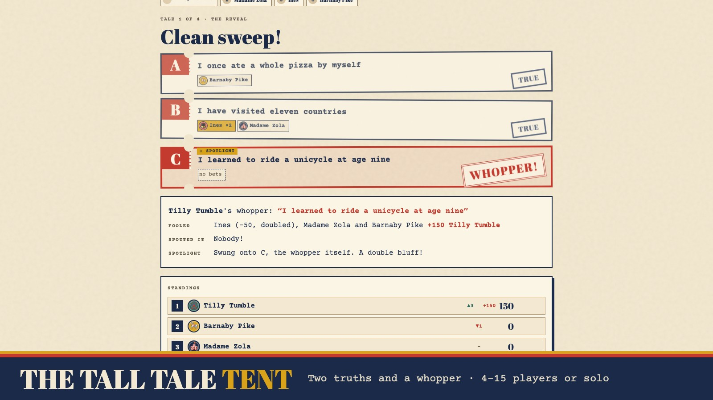

# The Tall Tale Tent: Submission

This is an entry for the Handshake AI Skills Studio "Create a Multiplayer Game" mission (OpenAI). Deadline: **Oct 30, 2026, 11:59 PM PT**.

The entry form asks for four things: a title, a cover image, a description and a link. Each one is below, ready to paste.

---

## a. Project title

```
The Tall Tale Tent: Two Truths and a Whopper
```

## b. Project cover image



Upload `cover_image.jpg` from this folder (also saved as `covers/tall-tale-tent-cover.jpg`). It shows the reveal screen, with the WHOPPER! stamp on the lie, who bet on each ticket, and who was fooled, plus the title band.

## c. Project description

**Short version** (about 60 words; use this if the form limits length):

```
Play alone right now: tap Practice with bots. Two truths and a lie at a county-fair sideshow, for 4–15 players. On your turn, swing the spotlight onto a ticket: a hint or a bluff? At Last Call the tote board shows the crowd's bets. Back the whopper early and win a long-shot bonus. Classroom mode and Barker moderation tools included.
```

**Full version:**

```
Play alone right now: enter a name, tap Practice with bots, and three sideshow performers join you in the tent.

Step into a faded striped tent at the county fair. Every player hands the Barker three short tales about themselves: two true, one a tall tale. Then each player steps into the spotlight. Their tales appear as three torn ticket stubs, A, B and C, shuffled by the server, and everyone else bets on which one is the whopper.

Three twists make it more than an icebreaker:

• Work the spotlight. Once per game, on your own turn, you swing the spotlight onto one of your tickets. Everyone sees it land, but only you know whether it's an honest hint, a bluff, or a double bluff. The author is now playing too, not just sitting there.
• Last Call and the tote board. Bets stay secret for 25 seconds. Then the carnival tote board flips and shows how the crowd split across A, B and C. You get six seconds to hold firm or follow the crowd. If you were already on the whopper while most people bet elsewhere, you earn a long-shot bonus of +50.
• The Go Double chip. One brass chip per game: right pays +200 instead of +100, wrong costs you 50.

Authors earn +50 for every person they fool, so a poker face matters as much as a sharp eye. The reveal stamps WHOPPER! on the lie, shows who bet on what, and calls out every bluffed spotlight.

Built for classrooms, new teams, remote hangouts and family gatherings, where people learn surprising things about each other.

Details:
• Join from any phone or laptop with a four-letter code. No login, no install.
• Classroom mode: first names only, a stricter word filter and 25% longer timers.
• The Barker (host) can extend the clock, skip a player, or remove a tale.
• A content filter blocks profanity, slurs, phone numbers, emails and links.
• Stuck? Prompt chips give writers a starter ("A trip that went wrong…").
• The lie never leaves the server until the reveal, and tales are deleted when the tent closes.
• A "Your move" bar tells each player what to do right now.
• It plays like a game show: carnival avatars, a live score HUD, a title card for each turn, a staged reveal (bets drop, truths flip, drum roll, WHOPPER! stamp), standings with ▲/▼ after every tale, 🔥 streaks, a podium finale and live emoji reactions.
• Awards: Best Poker Face, Sharp Eye, Boldest Bet, Long Shot and Smoke and Mirrors, plus the Whopper of the Night.
• Midway ranks from Rube to Legend of the Midway, eight ribbons, and a shareable ticket stub.
```

## d. Project link

```
(add the live Render URL here after deploying, e.g. https://the-tall-tale-tent.onrender.com/)
```

Source: _(add the GitHub repo URL after pushing)_

---

## Quick start for a judge (about 4 minutes)

1. Open the link, type a name, tap **Practice with bots**, then **Raise the curtain**.
2. Write three short tales about yourself, tap **Lie** beside the made-up one, and tap **Hand to the Barker**. Stuck? Tap a prompt chip.
3. When a bot is in the spotlight, read the three tickets. When betting opens, tap the one you think is the lie. Turn on **Go Double** if you're sure, then **Lock it in**. Watch out: the bot may swing the spotlight onto a ticket to bluff you.
4. At **Last Call** the tote board shows how the bots bet. Hold firm or switch, then watch the WHOPPER! stamp land.
5. On your own turn, tap **☼ Onto A/B/C** to swing the spotlight, keep a straight face, and see how many bots you fool.
6. After four tales, see the leaderboard, the awards and the Whopper of the Night.

## Before you submit

- [ ] Push this folder to a new GitHub repo, deploy it on Render (Build `npm install`, Start `npm start`, Health Check Path `/healthz`), and paste the URL above.
- [ ] Add an UptimeRobot monitor on `https://…onrender.com/healthz` so the free instance doesn't sleep.
- [ ] Play one full practice game on the live link, on a phone and on a laptop.
- [ ] Play one game with 4+ real people.
- [ ] Confirm the eligibility requirement: the entry must be a project built with the OpenAI "Create a Multiplayer Game" mission in Handshake. Be ready to explain how you built it.
- [ ] Paste the title, upload the cover, paste the description (short or full), and paste the link.
- [ ] Submit by Oct 29, not on the last day.
